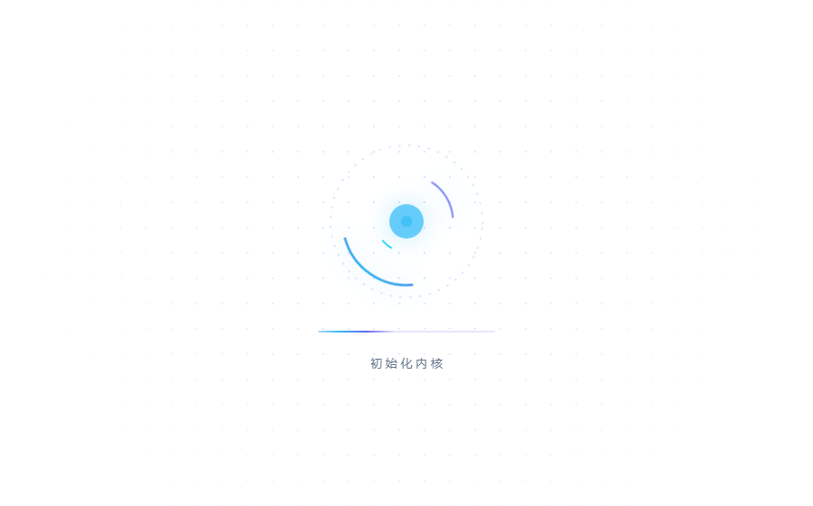

# dsh-desktop-restart-button

[English](README.md) | 中文

给 **Windows 上的 DeepSeek Harness 桌面端**加一个**重启按钮**，并把冷启动时那句干巴巴的「正在加载设置…」换成一个小科技感动画。

两样东西都是一行内联 index 注入脚本画出来的，**完全不碰 `app.asar`** —— 装上和卸掉之后，应用本体一个字节都没变。



## 为什么非得做成插件

桌面端标题栏的菜单条（`应用` / `编辑`）是 Electron preload 里写死两个按钮搭出来的，而且应用**没有暴露任何重启 IPC 通道，也没有命令行入口**——它自带的 `app.relaunch()` 菜单项只在开发构建里存在。`dsh plugin --profile desktop` 也走不通，因为 desktop profile 完全由 Electron 应用独占管理。

桌面端唯一对外开放的扩展点，是**把一行内联脚本推进 host 的 index 注入表**的 profile 插件。这个包就是它。

## 安装

桌面端的 profile 不能用命令行管理，要在应用自己的插件管理器里装：

1. 打开应用里的 **设置 → 插件**。
2. 搜索 `dsh-desktop-restart-button`（或从本地 tarball 安装）。
3. 重启一次应用。

按钮会出现在标题栏 `应用`、`编辑` 之后。非 Windows 平台上插件会正常加载但什么也不做：它要挂的菜单条只在 Windows 上存在，重启链路本身也是 WMI + PowerShell。

## 为什么重启必须要一个"外部"启动器

Electron 会把应用派生出来的进程统统放进 **Job Object**，应用一死，它派生的所有进程跟着死。所以用常规方式启动的重启器，会在关掉应用之后被一起杀掉 —— 用户就对着一个关掉的窗口发呆。那个 job 也不接受 `CREATE_BREAKAWAY_FROM_JOB`。

能跑通的链路，也就是这个插件用的：

```
点按钮
  → POST /dsh-desktop-restart-button/restart
  → execFile powershell scripts/launch.ps1
  → WMI Win32_Process.Create          ← 由 WmiPrvSE 创建，在 job 之外
  → wscript.exe scripts/launch.vbs    ← GUI 子系统程序，永远不弹控制台
  → restart.ps1                       ← 杀掉应用，再重新拉起
```

`wscript.exe` 不是随手写的：WMI 创建出来的 `powershell.exe` 一定会闪一个控制台窗口，`-WindowStyle Hidden` 压不住，`Win32_ProcessStartup.ShowWindow = 0` 也压不住（而 `CreateFlags = CREATE_NO_WINDOW` 会让 WMI 调用直接失败）。GUI 子系统程序 + `WshShell.Run(cmd, 0, False)` 是唯一能彻底不露头的组合。

作者机器上实测：**从点击到窗口回来约 5 秒**，其中大头是 Host 启动，不是重启动作本身。

## 安全

- **Origin 围栏。** 重启路由只接受 `dsh-app://app`（桌面端自己的 UI 就是这个源）和回环地址。你浏览器里随便哪个网页都调不到它。
- **同 job 保护。** `restart.ps1` 动手之前先调 `IsProcessInJob`。如果发现自己就在应用的 job 里（比如有人在应用托管的终端里手动跑了一下），它会通过 WMI 把自己重新派发出去，然后**不碰应用**直接退出，而不是把应用关掉再一起被带走。
- **不硬杀正常退出的进程。** 先请求应用关窗，只有在它还活着的时候才强杀，设置和会话的写入能正常落盘。
- **绝不留一个关着的应用。** 重新拉起失败时会连着重试最多一分钟才放弃。

日志：`%USERPROFILE%\.dsh\dsh-desktop-restart-button.log`

## 配置

```yaml
- id: dsh-desktop-restart-button
  name: dsh-desktop-restart-button
  config:
    bootAnimation: false
```

`bootAnimation` 默认 `true`。设成 `false` 就保留应用原来的「正在加载设置…」文案。因为注入表只在启动时收集一次，改完需要重启应用才生效。

## 关于开机动画

被替换掉的那层遮罩是应用的 onboarding 面板：Host 还在起的时候，它里面只有一个 `[role="status"]` 节点。插件**只认这一个精确状态**（有 status 节点、又没有引导内容的遮罩）并给这个元素打标记，再用属性选择器只隐藏标记元素上的文案 —— 真正的引导向导自己的文字不受影响。

动画本体是纯 CSS/SVG（三段反向旋转的弧、一个呼吸的核心、一条扫光条、一层缓慢漂移的点阵），带 `prefers-reduced-motion` 静态降级。没有 canvas，没有 rAF 循环，遮罩一卸载就什么都不剩。

## 说明与限制

- **只支持 Windows。** `dsh.bundle.platforms: ["win32"]`。
- **只支持桌面端。** 它挂的是 preload 搭出来的窗口菜单条，`dsh web` 里没有。在 Web 上装着无害，但看不见。
- 重启时拉起的是 `process.execPath`，也就是 host 自己所在的那个可执行文件；万一不是桌面端本体，会退回到 `D:\deepseek\DeepSeek Harness.exe`。
- 桌面端 **每次启动都换随机端口**，所以重启前那个页面地址在重启后是失效的。按钮不会替你把地址改过去。

## 许可

MIT
